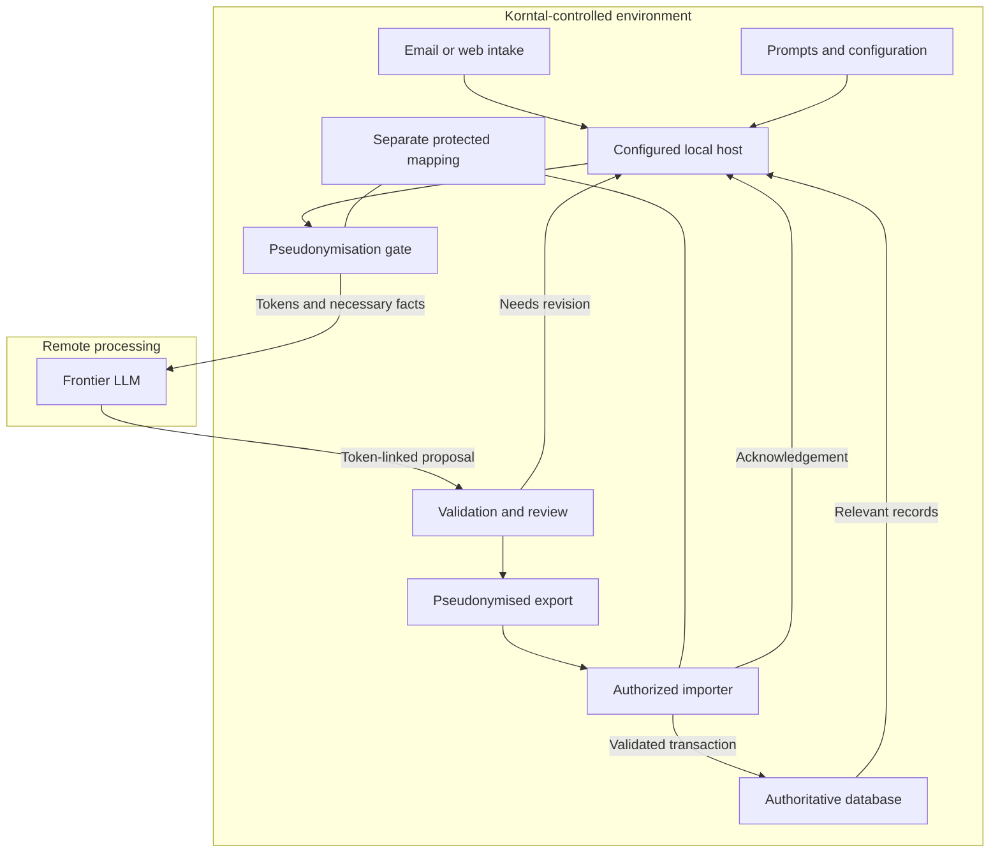

# How can an LLM help with room management and booking?

Animated video script and FFrames-oriented production storyboard · eight minutes

Video and service offered by **AMDG Engineers**. Proposed institutional setting: AWM / CIU Korntal.

Audience: reception, administration, and IT. English narration; German example input and animated labels. Use “LLM” or “language model” throughout the spoken presentation. Build the presentation from animated vector scenes, with narration and captions synchronized to the timeline.

The prompt series is the central component of this demonstration. It specifies how the LLM interprets a request, evaluates supplied room records, applies operating rules, and proposes an allocation. Its instructions can be edited and reused in a compatible LLM interface, an existing workflow, or the user's proprietary desktop app. Automated data retrieval, independent validation, file delivery, and database writes are supplied by the configured integration.

All guest details, room records, priorities, request references, filenames, interface screens, and database references below are fictional demonstration data. Korntal's actual internal configuration, inventory records, database schema, and integration have not been supplied. The example ends with a database record containing a room inquiry and a validated allocation proposal, with reservation approval pending.

## Animation and FFrames production profile

FFrames' official documentation describes Rust-defined videos built from SVG frame output, timed scenes, and positioned audio, encoded through FFmpeg. This storyboard supplies the scene, motion, and narration plan for that style of renderer. [5][6]

| Production item | Proposed setting |
| --- | --- |
| Format | 1920 × 1080; 16:9 |
| Frame rate | 30 frames per second |
| Duration | 480 seconds; 14,400 frames |
| Frame indexing | Zero-based; scene ends are exclusive |
| Visual medium | SVG cards, text, arrows, room tiles, occupancy strips, and status badges |
| Audio | Prepared narration clips aligned to scene cues; optional quiet transitions |
| Captions | Prepared from the final narration; at most two readable lines at a time |
| Fixture data | Fictional and fixed before rendering |
| Main visual emphasis | Editable prompts and the visible change in the LLM's room recommendation |
| Provider credit | AMDG Engineers — provider of the service and this video |

Prepare the narration and fixture responses before rendering. Drive animation from scene time and precomputed data; frame rendering must remain deterministic and free of live network, LLM, database, or file-reading operations. FFrames renders frames concurrently and documents pure frame rendering. [5]

Design choices for this video: a light neutral canvas, dark readable text, amber for prompts, blue for source data, violet for the remote LLM, green for validated outcomes, and red for conflicts. Pair color with text and icons. Keep essential content within a 96-pixel safe margin. Use large headings, short labels, and focused detail views. Long tables in this document are reference material; animate a few rows at a time.

For remote-exchange scenes, keep Korntal's controlled environment on the left and the remote processing zone on the right, separated by a labeled boundary. Show only pseudonymised packets crossing the boundary. A small locked mapping card remains on the Korntal side.

Use continuous movement and short opacity/position transitions. Hold important results still for reading. Avoid rapid decorative motion and rapid full-paragraph typing. Build narration pauses around the prompt edit, the identity-token transformation, and the database acknowledgement.

Use the exact provider name “AMDG Engineers” as a typographic wordmark. Reveal the provider credit after the opening question, retain a discreet text credit during the demonstration, and show a clear closing card. Approved logo assets, brand colors, and contact details can be incorporated when supplied; the current storyboard uses the name as text.

## Verified institutional context

CIU Korntal is the academic branch of AWM and the European campus of Columbia International University. AWM publicly offers accommodation for students and seminar participants. Its website describes room requests through course-registration forms and reception email outside course and seminar periods. These public facts establish the setting. The workflow and internal data shown here are proposals. [1][2]

Companion instruction set: [Room management and booking — eight modules and applied prompt series](https://chatgpt.com/library?file_id=libfile_fdbffd7ebc50819199a9b4e4631961dd&account_id=personal).

## Scene 1 · 00:00–00:25 · Open with the question

**Visual**

Display the opening question:

> How can an LLM help with room management and booking?

After the opening question, reveal the credit “Video and service offered by AMDG Engineers”. Then reveal four labeled cards: “Request”, “Room data”, “Korntal configuration”, and “Editable prompt series”. The cards converge on “LLM evaluation”.

**Animation cues — scene-local time**

0–4 s: reveal the opening question and hold. 4–8 s: reveal the AMDG Engineers provider credit beneath the question. 8–15 s: bring in request, room-data, configuration, and prompt cards. 15–25 s: connect the cards to the LLM; keep the prompt card highlighted and the provider name visible.

**Narrator**

> How can an LLM help with room management and booking? AMDG Engineers offers a service built around editable prompts. These instructions guide an LLM through guest requests, room data, and Korntal's operating rules to propose suitable allocations. The prompt series can be revised and reused in compatible interfaces.

## Scene 2 · 00:25–01:00 · Show what the prompts contribute

**Visual**

Open the actual eight-module prompt document. Highlight Module 4:

> Check whether a feasible room assignment exists for the complete request, including special features and continuity.

Show a compact index:

| Prompt modules | Responsibility |
| --- | --- |
| 1–2 | Role, authority, source data, inventory, and operating rules |
| 3 | Interpret dates, occupants, room needs, and constraints |
| 4 | Evaluate availability and feasible room allocations |
| 5–6 | Apply commercial conditions and lifecycle rules |
| 7 | Specify the operational result and unresolved issues |
| 8 | Preserve traceability, reconciliation, and handover |

**Animation cues — scene-local time**

0–9 s: assemble eight short module cards in a two-column grid. 9–24 s: enlarge Module 4 and its allocation instruction. 24–35 s: move the same prompt card between a generic LLM interface and a desktop-host icon.

**Narrator**

> The eight modules provide shared system instructions. A companion task prompt selects the current operation, such as evaluating an inquiry. Together they define the working procedure and expected answer. You can begin in an LLM interface with supplied records, then reuse the instructions through a desktop app or CLI. The host supplies the data exchange, permissions, and independent checks.

**Production note**

The existing document specifies concurrent modules. Do not animate them as eight mandatory sequential model calls. The priority edits demonstrated later are explicit example additions to the task prompt; the source eight-module document remains unchanged.

## Scene 3 · 01:00–01:35 · A guest supplies the request

**Visual**

Show an email labeled “Fiktive Beispieldaten”.

From: Lea Beispiel · lea.beispiel@example.com

Subject: Zimmeranfrage, 16.–19. November 2026

> Guten Tag,
>
> ich möchte für eine Person ein Einzelzimmer vom 16. bis zum 19. November 2026 anfragen. Ich komme voraussichtlich gegen 18 Uhr an.
>
> Können Sie mir bitte mitteilen, ob das möglich ist?
>
> Freundliche Grüße
> Lea Beispiel

Briefly show an alternative web form containing the same dates, one person, single-room preference, and estimated arrival time. Label this “Alternativer Eingang”; continue processing the original email.

**Animation cues — scene-local time**

0–10 s: reveal the fictional email inside the controlled-intake area. 10–23 s: highlight dates, one person, and single-room preference. 23–35 s: show the alternative form briefly, then move one request card to local processing.

**Narrator**

> Lea requests a single room for one person, from the sixteenth to the nineteenth of November. She expects to arrive around six in the evening. The same information could arrive through a web form. The host registers the source under request reference DEMO-001 and makes the relevant request content available for the selected task.

## Scene 4 · 01:35–02:15 · Supply database records and Korntal configuration

**Visual**

Show the desktop app receiving a read-only data package from an authorized database interface or export. Display “DEMO-SNAPSHOT-01 — vollständiger Datenumfang für dieses Beispiel”.

All availability statements below refer to the requested stay, 16–19 November 2026.

| Room reference | Type | Size | Maximum occupants | Relevant commitment or restriction |
| --- | --- | --- | --- | --- |
| DEMO-S1 | Single | 12 m² | 1 | No conflicting booking, hold, closure, or turnaround restriction |
| DEMO-S2 | Single | 18 m² | 1 | No conflicting booking, hold, closure, or turnaround restriction |
| DEMO-D1 | Double | 24 m² | 2 | Booked during 17–18 November |
| DEMO-S3 | Single | 14 m² | 1 | Maintenance block during 16–17 November |

Alongside it, display the proposed demonstration configuration:

| Configuration item | Demonstration value |
| --- | --- |
| Rooms in the supplied demonstration scope | 4 |
| Property time zone | Europe/Berlin |
| Required room continuity | Same room for the complete stay |
| Existing bookings, holds, and maintenance blocks | Must be respected |
| Authorized task | Evaluate inquiry and propose an allocation |
| Reservation commitment | Requires the established approval and booking process |

**Animation cues — scene-local time**

0–12 s: reveal the four room cards with size and capacity. 12–28 s: animate the three requested nights across an occupancy strip; mark the booking overlap and maintenance interval. 28–40 s: place the configuration card beside the source snapshot and hold the complete context.

**Narrator**

> Next, the host supplies the relevant database records: room identifiers, sizes, capacities, occupancy, holds, and restrictions. Korntal configuration supplies the operating context and permitted action. Here, four fictional rooms form the complete demonstration scope. The package identifies its source, coverage, and observation time. The LLM can now evaluate the request against concrete records.

**Production note**

These four rooms are invented for the demonstration and do not represent Korntal's actual inventory. Published institutional information is not a source of live occupancy. Room counts and capacity must reconcile with the authorized inventory; conflicting records require resolution.

## Scene 5 · 02:15–02:55 · Pseudonymise before remote processing

**Visual**

Split the frame into “Korntal — kontrollierter Bereich” and “Entfernte LLM-Verarbeitung”. On the Korntal side, show the fictional source identity and the separate protected mapping:

| Local information | Outbound representation |
| --- | --- |
| Lea Beispiel and contact details | GUEST-7Q4M; contact details omitted |
| Local request DEMO-001 | Operation token OP-8N2K |
| Local source DEMO-SNAPSHOT-01 | Source token SRC-4B2R |
| Necessary stay and room facts | Task-relevant dates, quantities, capacity, size, and availability |
| Other guests' reservation details | Necessary occupied intervals and pseudonymous references; identifying details omitted |

The names and contact data remain on the controlled side. The packet crossing the boundary contains tokens and necessary task facts. Keep the mapping card stationary inside Korntal's environment.

**Animation cues — scene-local time**

0–8 s: mark identifying items in the local source. 8–18 s: replace them in the outbound view with tokens; remove unnecessary contact fields. 18–28 s: show the separate mapping staying local. 28–40 s: move the pseudonymised packet through the boundary to the remote processing zone.

**Narrator**

> Before data goes to the remote LLM, local processing replaces identifying references with pseudonyms and removes unnecessary personal details. The identity mapping stays under Korntal's control. The LLM receives the guest token and the room facts needed for the task. Its reply keeps the tokens. Authorized local processing can later reconnect the validated result with the original request.

**Production note**

Apply this gate to every onward remote processing request and its associated traces or exports, including repeat evaluations after a prompt edit. Review free text, attachments, headers, source notes, existing occupants, and configuration for identifying content. Retain only necessary context. Pseudonymised information can remain personal data when attribution remains possible; pseudonymisation must be supported by separate protected mapping and appropriate controls. [7]

The original guest email or form arrives through Korntal's approved intake. The pseudonymisation requirement shown here applies before onward remote processing after intake. The video must depict that boundary accurately.

## Scene 6 · 02:55–03:35 · Assemble the LLM request

**Visual**

Show a readable view of the model request with separate sections:

| Section | Supplied content |
| --- | --- |
| System instructions | The eight room-management modules |
| Current task | Evaluate the inquiry and propose suitable rooms |
| Source data | Relevant occupancy and room facts, with pseudonymous source reference SRC-4B2R |
| Institutional configuration | The approved operating context and constraints |
| Guest input | Locally pseudonymised request content, linked to guest token GUEST-7Q4M and operation token OP-8N2K |
| Result requirements | Room references, recommendation, alternatives, reasons, missing information, and proposed action |

Highlight the demonstration task instruction:

> Evaluate this inquiry using the supplied room records and configuration. Check the full stay, occupancy conflicts, capacity, required room type, and closures. Among eligible rooms, prefer the smallest room that satisfies the request. Return the recommended room, alternatives, exclusion reasons, source reference, and unresolved information.

**Animation cues — scene-local time**

0–12 s: stack system prompts, task, pseudonymised facts, and configuration as distinct layers. 12–25 s: highlight the smallest-suitable-room instruction. 25–40 s: send one tokenized packet to the LLM and return a structured proposal.

**Narrator**

> The host combines the prompt series, task instruction, necessary room facts, configuration, and pseudonymised guest request into the model request. The prompt directs the LLM to check dates, occupancy, capacity, room type, and restrictions, then compare eligible rooms. For this first demonstration revision, it also asks the LLM to prefer the smallest suitable room. The frontier LLM returns its evaluation in the required structure.

**Production note**

Keep trusted instructions and approved configuration distinguishable from external messages. Every remote model request uses the local pseudonymisation gate. Exclude names, addresses, email headers, signatures, credentials, and unnecessary free text; replace required identifying references with approved tokens. Other guests' occupancy records contribute only necessary availability facts and pseudonymous references. The table illustrates logical sections rather than a provider-specific API schema.

## Scene 7 · 03:35–04:10 · Show the LLM evaluating the rooms

**Visual**

Reveal the returned evaluation alongside the supplied records:

| Room | LLM's proposed assessment |
| --- | --- |
| DEMO-S1 | Eligible for the full three-night stay; recommended under the smallest-suitable-room priority |
| DEMO-S2 | Eligible alternative; larger than DEMO-S1 |
| DEMO-D1 | Excluded: occupancy overlap; also differs from the requested room type |
| DEMO-S3 | Excluded: maintenance overlaps the requested stay |

Then show:

| Result item | Demonstration response |
| --- | --- |
| Operation token | OP-8N2K |
| Source token | SRC-4B2R |
| Recommended room | DEMO-S1 |
| Eligible alternative | DEMO-S2 |
| Stay | 2026-11-16 to 2026-11-19; 3 nights |
| Proposed action | Record inquiry with allocation recommendation |
| Open questions | Applicable price, acceptance, meals if required, and arrival arrangements |
| Reservation status | Proposed; approval pending |

**Animation cues — scene-local time**

0–12 s: assess DEMO-S1 and DEMO-S2 with green eligible badges. 12–24 s: mark the occupancy and maintenance exclusions. 24–35 s: pin DEMO-S1 as the recommendation and DEMO-S2 as the alternative; show the guest and source tokens on the returned packet.

**Narrator**

> The LLM proposes room DEMO-S1 and identifies DEMO-S2 as an alternative. It explains the exclusions using the supplied occupancy and maintenance records. It preserves the three-night stay and identifies information still needed for the booking process. The response contains the requested allocation analysis, with room references and concise reasons that staff and application checks can inspect.

## Scene 8 · 04:10–05:00 · Edit the prompt and evaluate the same data again

**Visual**

Keep the guest request, room snapshot, and institutional constraints fixed. Change only the task prompt's selection priority.

**First task-prompt revision**

> Among eligible rooms, prefer the smallest room that satisfies the request.

**Revised task-prompt instruction**

> Among eligible rooms, prefer the largest single room that satisfies the request, to prioritize space for the guest.

The operator selects “Mit geändertem Prompt erneut auswerten”. Compare the responses:

| Result | First revision | Revised priority |
| --- | --- | --- |
| Recommended room | DEMO-S1 · 12 m² | DEMO-S2 · 18 m² |
| Eligible alternative | DEMO-S2 | DEMO-S1 |
| Blocked rooms | DEMO-D1 and DEMO-S3 excluded | DEMO-D1 and DEMO-S3 excluded |
| Data and hard constraints | DEMO-SNAPSHOT-01; unchanged | DEMO-SNAPSHOT-01; unchanged |

**Animation cues — scene-local time**

0–12 s: edit only the selection-priority sentence. 12–25 s: send the same facts through the pseudonymisation gate again. 25–40 s: animate the recommendation changing from DEMO-S1 to DEMO-S2 while blocked-room markers stay fixed. 40–50 s: hold the before/after comparison and show the new prompt revision.

**Narrator**

> Now reception edits the prompt to prioritize space among suitable single rooms. The same request, data snapshot, and constraints pass through the pseudonymisation gate and are evaluated again. The recommendation changes to DEMO-S2. This makes the benefit visible: the selection procedure can be adjusted through editable instructions while the existing data interface continues to serve the task. Staff record the prompt revision and review the resulting proposal.

**Production note**

This is an illustrative priority change for the demonstration. Use an authorized policy decision for production. Preserve the request reference, identify successive processing revisions, and export only the selected approved result. Prompt changes must remain compatible with confirmed constraints, available data, the response contract, and independent validation.

## Scene 9 · 05:00–05:40 · Validate the model's proposal

**Visual**

Show the revised result beside the source records and the updated prompt. A validation panel displays:

| Independent check | Demonstration result |
| --- | --- |
| Referenced room exists in the supplied scope | DEMO-S2 found |
| Dates and nights | Valid dates; 3 nights recalculated |
| Room type and capacity | Single room; capacity 1 |
| Occupancy, holds, and blocks in supplied records | No conflict for DEMO-S2 |
| Updated selection priority | DEMO-S2 is the largest eligible single room |
| Permitted operation | Inquiry and allocation proposal |
| Required output structure | Accepted under the demonstration contract |
| Source and prompt references | Present |

The operator reviews the proposal and selects “Geprüften Vorschlag für Import freigeben”.

**Animation cues — scene-local time**

0–16 s: check structure, room reference, dates, capacity, and source consistency in sequence. 16–28 s: resolve the validated guest token inside the controlled area for the authorized review. 28–40 s: reveal the operator approval and resulting export-ready state.

**Narrator**

> Independent application checks verify the proposed room against the source records, recalculate dates, check the allowed action, and validate the response structure. After validation, authorized local processing resolves the guest token for reception's review. Reception approves the selected result in this pilot. Missing information remains explicit. A failed check returns the proposal for correction. Changes to the prompt and the returned answer remain traceable through their processing revisions.

**Production note**

The prompts describe the required analysis and answer. The host enforces its validation and execution controls. Schema validation checks structure; domain checks evaluate consistency and permitted operations. Live availability must be checked again when inventory is actually committed. [3][4]

## Scene 10 · 05:40–06:20 · Export the validated result

**Visual**

Show the approved proposal becoming a structured data package. Publish a completed file into a protected export folder:

`room-request-OP-8N2K.json`

Display these logical contents:

| Package item | Demonstration value |
| --- | --- |
| Operation and source tokens | OP-8N2K; SRC-4B2R |
| Guest reference | GUEST-7Q4M; identity mapping retained separately under Korntal control |
| Stay and occupancy | 2026-11-16 to 2026-11-19; 3 nights; 1 person |
| Proposed room | DEMO-S2 |
| Eligible alternative | DEMO-S1 |
| Selection reason | Largest eligible single room under the reviewed priority |
| Proposed operation | Record inquiry and allocation proposal |
| Traceability | Pseudonymous source and approval references; prompt and processing revisions |
| Unresolved items | Price and acceptance, meals if required, arrival arrangements |
| Exchange metadata | Agreed schema version and stable operation reference |

**Animation cues — scene-local time**

0–12 s: assemble the approved package using guest and operation tokens. 12–26 s: finish the file and publish it to the protected folder. 26–40 s: hold the completed file with source, prompt, and approval-reference badges; keep the mapping outside the package.

**Narrator**

> The host packages the approved result for Korntal's import process. The file carries the proposed room, pseudonymous guest and operation references, necessary request data, unresolved items, and traceability references. JSON is the proposed exchange format here. Korntal IT defines the exact schema. A completed-file handover ensures the importer receives the finished package.

**Production note**

Keep the export pseudonymised through the handover. The separate identity mapping stays under Korntal control and is available only to authorized local processing. Use a protected folder and a completed-file protocol appropriate to the deployed filesystem. Where supported, write and close a temporary file, then atomically rename it into the ready location on the same filesystem. Keep credentials and unnecessary model output outside the export.

## Scene 11 · 06:20–07:15 · Korntal imports the proposal

**Visual**

The Korntal-managed importer receives the completed file. Display “Herkunft”, “Schema”, “Berechtigung”, “Quelldatenstand”, and “Duplikatprüfung”.

Then show a database transaction receiving the inquiry and proposed room reference.

**Animation cues — scene-local time**

0–18 s: move the file to the Korntal importer and reveal its checks. 18–34 s: show authorized local token resolution and data mapping. 34–55 s: animate the transaction write, stable operation reference, and successful commit.

**Narrator**

> Korntal's importer verifies the handover, schema, operation permissions, record mapping, and relevant data freshness. The stable operation reference protects retries from creating duplicate records. Changed source records trigger revalidation under the agreed import rules. Inside Korntal's controlled environment, the authorized importer resolves the tokens to approved local references. In this demonstration, the transaction records the inquiry and room proposal. A confirmed reservation would additionally require the authoritative booking process to allocate capacity under its current conditions.

**IT dialogue**

> “DEMO-001 wurde geprüft. Wir übernehmen die Zimmeranfrage mit dem Vorschlag DEMO-S2 und den zugehörigen Quellen- und Promptreferenzen.”

**Production note**

Use fixed, authorized data mapping and database operations. Keep database credentials with the importer. Enforce duplicate protection in the database or authoritative import layer. If reservation commitment is included, check current availability, accepted terms, authorization, and required payment conditions within the supported booking transaction.

## Scene 12 · 07:15–08:00 · Finish with the acknowledged database entry

**Visual**

After a successful commit, show a simulated acknowledgement:

| Result item | Demonstration value |
| --- | --- |
| Local request reference | DEMO-001 |
| Remote-safe operation reference | OP-8N2K |
| Local database record | DEMO-DB-1042 |
| Recorded proposal | DEMO-S2 |
| Import outcome | Committed |
| Business status | Inquiry and allocation proposal recorded; reservation approval pending |

The host displays:

> Anfrage DEMO-001 mit Zimmervorschlag DEMO-S2 übernommen. Datenbankreferenz: DEMO-DB-1042. Buchungsfreigabe ausstehend.

Show the editable prompt beside the acknowledged record, then finish with a closing card:

> AMDG Engineers
>
> Prompt-based room management with an LLM
>
> Video and service offered by AMDG Engineers

**Animation cues — scene-local time**

0–15 s: return the acknowledgement, with tokens on any remote leg. 15–30 s: connect the local request, prompt revision, proposed room, and database result. 30–38 s: hold the recorded proposal beside the editable prompt. 38–45 s: transition to the AMDG Engineers closing card and hold it for reading.

**Narrator**

> After the database commit succeeds, the importer returns the actual result. Any acknowledgement travelling outside the controlled environment uses pseudonymous references. The host links it to the request and its prompt revision. We can follow the record from guest input through supplied data, LLM evaluation, prompt changes, validation, and database entry. The editable prompts carry the procedure; the configured interfaces manage the data and operational controls. AMDG Engineers offers this service and this video.

## Data flow for the animator

For the video, reveal this topology in stages and emphasize the active path. Keep the mapping in the controlled area throughout. The diagram is a production reference; redraw it as animated SVG rather than filming a static diagram.

The host can be the user's desktop app or another compatible environment. A manual workflow requires authorized local preparation and pseudonymisation before supplying material to a remote LLM. Automated operation requires configured data access, pseudonymisation, validation, and import components.

## What is editable, and where?

| Component | Content | Effect of an authorized change |
| --- | --- | --- |
| Shared prompt modules | Role, analysis procedure, source handling, lifecycle instructions, and reporting requirements | Changes how the LLM approaches the supported tasks |
| Task prompt | Current operation and permitted selection priorities | Changes the requested evaluation or proposal |
| Korntal configuration | Property scope, time zone, operational restrictions, authorization, and established policies | Changes the institutional conditions applied to the task |
| Database source records | Actual rooms, capacity, features, occupancy, holds, and blocks | Changes the facts available for evaluation |
| Input/output contract | Supported data fields, types, references, and permitted operation structure | Changes the integration contract; may require corresponding application and importer changes |
| Validation and transaction logic | Independent checks, permissions, duplicate protection, and database commitment | Enforces the execution conditions; changes require the appropriate implementation and review |

Prompt wording and compatible selection priorities can be revised without rebuilding a dedicated booking interface. A prompt revision that requires new data, new capabilities, different output fields, or altered execution permissions also requires the corresponding integration work. Validate revisions against representative requests and known expected outcomes before production use.

## Data management and status boundaries

| Stage | Data managed | Result |
| --- | --- | --- |
| Intake | Original request, source, receipt time, and stable request reference | Received |
| Context preparation | Relevant database snapshot, coverage, source versions, and institutional configuration | Evaluation context ready |
| Pseudonymisation | Necessary facts linked to guest, operation, and source tokens; separate protected mapping | Approved remote payload |
| Model request | Shared prompts, task prompt, necessary pseudonymised context, and reviewed external content | Submitted for evaluation |
| Model response | Proposed allocation, alternatives, exclusion reasons, and unresolved issues | Proposal returned |
| Prompt revision | Authorized instruction change linked to a new processing revision | Revised evaluation returned |
| Validation and review | Independent check results and the selected approval | Approved for export |
| File handover | Pseudonymised package with source, prompt, and approval references | Export ready |
| Import and transaction | Authorized local token resolution, revalidated mapping, duplicate-protection reference, inquiry, and room proposal | Database commit or a reported error |
| Acknowledgement | Actual outcome and assigned database reference | Import acknowledged |

## Optional exception inserts

| Situation | Screen action | Suggested narration |
| --- | --- | --- |
| Occupancy data missing | Mark availability unverified and request the needed source coverage. | “The prompts direct the LLM to identify missing evidence before recommending an allocation.” |
| Prompt requests a choice contrary to a confirmed hard constraint | Flag the conflict and withhold approval. | “Selection priorities operate within the established requirements and execution controls.” |
| Returned room reference is absent from source data | Validation rejects the proposal. | “The host checks room references against the authorized inventory.” |
| Outbound material contains unexpected identifying details | Withhold remote submission and return to local review. | “The local pseudonymisation gate checks the material before it crosses the boundary.” |
| Returned guest token cannot be resolved | Keep the result unlinked and withhold import. | “Authorized local processing resolves only recognized tokens for this operation.” |
| Relevant occupancy changes after evaluation | Revalidate or refresh the context and evaluate again. | “The importer handles the changed source state before the requested operation proceeds.” |
| Import result is lost | Query the stable operation reference before retrying. | “The host resolves the committed outcome through the import reference.” |

## Frame and audio handoff for the Rust implementer

These are production timings for the proposed 30 fps, eight-minute edit. Frame ends are exclusive.

| Scene | Timeline | Duration | Frame range |
| --- | --- | --- | --- |
| 1 · Opening question | 00:00–00:25 | 25 s | 0–750 |
| 2 · Prompt modules | 00:25–01:00 | 35 s | 750–1800 |
| 3 · Guest input | 01:00–01:35 | 35 s | 1800–2850 |
| 4 · Database facts and configuration | 01:35–02:15 | 40 s | 2850–4050 |
| 5 · Pseudonymisation | 02:15–02:55 | 40 s | 4050–5250 |
| 6 · Model request | 02:55–03:35 | 40 s | 5250–6450 |
| 7 · LLM allocation analysis | 03:35–04:10 | 35 s | 6450–7500 |
| 8 · Prompt edit and comparison | 04:10–05:00 | 50 s | 7500–9000 |
| 9 · Validation and local review | 05:00–05:40 | 40 s | 9000–10200 |
| 10 · File handover | 05:40–06:20 | 40 s | 10200–11400 |
| 11 · Import and database transaction | 06:20–07:15 | 55 s | 11400–13050 |
| 12 · Acknowledgement and closing | 07:15–08:00 | 45 s | 13050–14400 |

Prepare one narration clip per scene or an equivalently aligned master track. Align each clip to its scene start after measuring the recorded voice. Keep important reveal and hold cues synchronized to the relevant words. If a clip overruns, revise the edit and frame table together. Generate captions from the final recorded narration.

Prepare all room records, returned proposals, prompt revisions, identity-token displays, and acknowledgement text as fixed fixtures. Inspect representative frames at the boundary crossing, each room recommendation, the prompt edit, token resolution, file publication, and commit. Confirm text remains readable and that no identity or mapping appears in a remote packet, subtitle, remote log visualization, or shared export.

Check the installed FFrames version's documented scene, SVG animation, audio, and rendering interfaces when implementing. This deliverable is the script and motion brief.

Include the AMDG Engineers opening credit, ongoing text credit, spoken attribution, and closing card in the render. The provider attribution is user-provided. The AWM / CIU Korntal material identifies the proposed use case; the video should describe the proposed service accurately within that setting.

## Production decisions for Korntal IT

This demonstration proposes a reviewed pilot, source data supplied to the host, local pseudonymisation before remote processing, a separate protected identity mapping, versioned prompt use, pseudonymised JSON exchange, a protected export folder, a Korntal-managed importer, and a returned acknowledgement. The destination record contains the inquiry and proposed allocation.

Agree the actual source interface, inventory scope, configuration authority, prompt-change permissions, pseudonymisation scope, mapping custody and access, input/output schema, destination mapping, validation responsibilities, duplicate protection, and result channel. Approval of an export and approval of a reservation are separate operational events whose states must remain explicit.

The public website supplies institutional context. Live inventory and booking conditions come from authorized operational records. Provider selection, data processing, retention, and access controls follow the institution's approved deployment arrangements.

## Research sources

Accessed 1 November 2026. Institutional facts are sourced below; the demonstration data and workflow choices are proposed.

1. [AWM Korntal — Studium](https://awm-korntal.eu/studium/): identifies CIU Korntal and its relationship to AWM and Columbia International University.
2. [AWM Korntal — Unterkunft und Verpflegung](https://awm-korntal.eu/faq/unterkunft-verpflegung/): describes accommodation and the registration-form and reception-email routes. The [FAQ](https://awm-korntal.eu/faqs/) was also checked.
3. [OWASP LLM security guidance — Prompt Injection](https://genai.owasp.org/llmrisk/llm01-prompt-injection/): supports independent validation, restricted privileges, separation of external input, and suitable human control.
4. [JSON Schema — What is JSON Schema?](https://json-schema.org/overview/what-is-jsonschema): describes structural and constraint validation for JSON exchange.

5. [FFrames Rust documentation](https://docs.rs/fframes/latest/fframes/): SVG frame rendering, scene and audio timelines, concurrent frame rendering, and FFmpeg encoding. The inspected documentation identifies version 1.3.0.
6. [FFrames official repository](https://github.com/dmtrKovalenko/fframes): the Rust/SVG video framework referenced for the animation handoff.
7. [European Data Protection Board — Secure personal data, pseudonymisation](https://www.edpb.europa.eu/sme/be-compliant/secure-personal-data_en): separate protected additional information and the continuing personal-data status of reidentifiable pseudonymised records.
